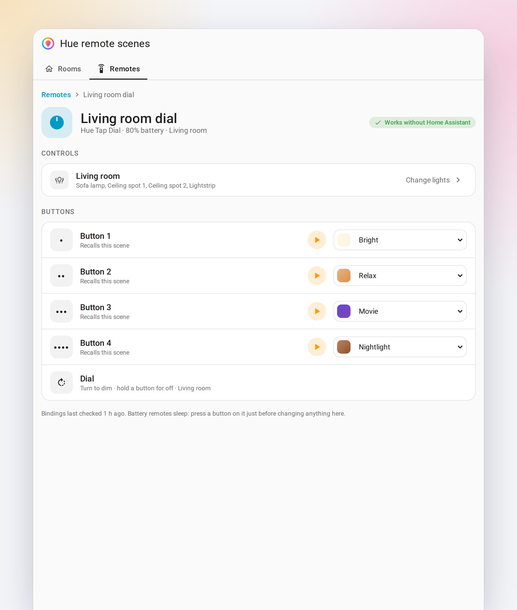

<h1>
  <picture>
    <source media="(prefers-color-scheme: dark)" srcset="custom_components/hue_remote_scenes/brand/dark_logo@2x.png">
    
  </picture>
</h1>

Make your Philips Hue remotes recall scenes stored in your lamps, on Home Assistant's **ZHA**, without a Hue Bridge. Press a button and the lamps change straight away over Zigbee, even when Home Assistant is down.

- **Hue Tap Dial set-up.** Each button recalls its own scene, the dial dims, and holding a button turns the lights off. A guided set-up finds the dial's built-in group, creates it in ZHA with the lamps you pick, and binds the dial. Then you save a scene for each button.
- **Hue dimmer switches.** On the gen 2 dimmer (RWL022), the Hue button alternates between two scenes stored in the lamps, set up the same way as the Tap Dial. Gen 1 dimmers (RWL020/RWL021) and the Hue smart button (ROM001) can't recall scenes themselves, so Home Assistant cycles through a list of scenes when you press On (or double-press the smart button). That part **needs Home Assistant running**; on/off and dimming still work without it.
- **Scenes stored in the lamps.** Set a ZHA group's lamps how you want them, then save. Every lamp stores its own state. Each scene also becomes a `scene.` entity for dashboards and automations.
- **Import.** Scenes already stored in your lamps (for example, ones made in Zigbee2MQTT before moving to ZHA) can be read back, then named.
- **Remote → group binding.** Bind remotes to ZHA groups, and see what each remote is bound to.

Built for Hue lamps and remotes. Other Zigbee lamps that support scenes can be in the same groups.

Looking for Hue's preset and animated (dynamic) scenes on ZHA? See [ZHA Scenes by marcelveldt](https://github.com/marcelveldt/zha-scenes). Hue Remote Scenes is about your remotes. If you use both, keep each group managed by one of them.

> ⚠️ Early and experimental. Tested against simulated devices only so far. Please report what works with your lights and remotes.

<p>
  <picture>
    <source media="(prefers-color-scheme: dark)" srcset="docs/areas-dark.png">
    
  </picture>
</p>
<p>
  <picture>
    <source media="(prefers-color-scheme: dark)" srcset="docs/area-dark.png">
    
  </picture>
  <picture>
    <source media="(prefers-color-scheme: dark)" srcset="docs/remotes-dark.png">
    
  </picture>
</p>

## Install

[](https://my.home-assistant.io/redirect/hacs_repository/?owner=elliotwestlake&repository=hue-remote-scenes&category=integration)

**Marketplace** (HA 2026.11+, formerly HACS): use the button above, or **Settings → Marketplace** → ⋮ → Custom repositories → add this repo as an *Integration*. Install, then restart HA. On older HA, both work the same way in HACS.

**Manual:** copy `custom_components/hue_remote_scenes` into your HA `config/custom_components/`, then restart.

Then go to **Settings → Devices & services → Add integration → Hue Remote Scenes**. A **Hue remote scenes** panel appears in the sidebar (admins only).

You need ZHA groups first: **Settings → Devices & services → Zigbee Home Automation → Configure → Groups** (a Tap Dial's set-up creates its own). The panel sorts groups and remotes into your Home Assistant areas, so give lights and remotes an area.

## The panel

- **Rooms** shows a card per Home Assistant area, tinted with the colours its lights are showing, with an on/off switch and a brightness bar (they control ZHA's group light). A banner flags any remote that isn't set up yet.
- **Open a room** to see its scenes as tiles in the colours they were saved with: tap one to recall it, use ⋮ to save the lights' current state over it, rename or delete it, and **Save current state** to add one. Its lights are listed below, each with its own switch and brightness, then the room's remotes.
- **Remotes** lists every remote by room, each with what it does, small swatches of its button scenes and whether it's set up. Open one to see what each button does: on a Tap Dial or gen 2 dimmer, pick a scene for each button (or save the lights' current state to it), and try it with ▶.

## Scenes

1. Set the group's lights to the look you want (from HA or the remotes).
2. Open the room and press **Save current state** (the dashed tile), then name it.
3. Recall it by tapping its tile, with `scene.turn_on` on its entity (which supports `transition`), or from a bound remote.

The panel says which lights saved it. A light that was off the network when you saved gets flagged "on 2 of 3 lights"; use **Save the lights' current state here** in its ⋮ menu to save it again. Delete (same menu) removes the scene from the lights too. A scene's colour shows what the lights looked like when it was saved; imported scenes show grey until you save them again.

Recall is sent to the whole group in one Zigbee message, so the lights change together. Afterwards the lights are re-read so ZHA's light entities show the new state.

### Actions

```yaml
action: hue_remote_scenes.store_scene    # new scene from the current state
data:
  group_id: 5
  name: Relax

action: hue_remote_scenes.store_scene    # overwrite an existing one
data:
  group_id: 5
  scene_id: 1

action: hue_remote_scenes.import_scenes  # read back scenes the lights already have
data:
  group_id: 5
```

Both return a response with the result (which lights saved it, or which scenes were found).

## Remotes

**Remotes** lists devices that send on/off, dimming or scene commands. Open one, pick a group and press **Bind**. Battery remotes sleep, so **press a button on the remote just before** binding or checking bindings.

Hue Remote Scenes remembers what each remote is bound to, so the panel shows what each remote controls without waking anything. Bindings made outside Hue Remote Scenes appear after **Check bindings** on the remote. A group's area is the one set on ZHA's group light entity, or otherwise the areas of its lights.

## Hue Tap Dial scene buttons

Once a Hue Tap Dial is set up, its four buttons recall scenes **stored in the lights**, without Home Assistant. Turning the dial dims, and holding any button turns the lights off. The catch is that each dial always uses its own built-in group, so the lights have to be in a group with exactly that ID. Open the dial under **Remotes** (or press **Set up** on the banner) and it walks you through it:

1. **Find its group:** press one of the dial's scene buttons a few times while Hue Remote Scenes waits. It reads the group ID from the press.
2. **Create the group:** tick the lights the dial should control. Hue Remote Scenes creates a ZHA group with the dial's ID (or adds the lights, if ZHA already has it).
3. **Bind:** press a dial button, then **Bind**.
4. **Save button scenes:** there's a slot per button (● to ●●●●). Set the lights, then **Save current state** in each slot.

After that, the dial's page lists each button with its scene. Pick another saved scene for a button and it's copied inside the lights to that button's slot (the Zigbee *copy scene* command, so the lights don't change), or choose **Save the lights' current state…**. **Change lights** adds lights to the dial's group.

The buttons recall scenes 1, 0, 5 and 4 (the IDs come from [Zigbee2MQTT's Tap Dial docs](https://www.zigbee2mqtt.io/devices/8719514440937_8719514440999.html)). Other scenes you save in that group skip those IDs.

## Hue dimmer switches

**Gen 2 dimmer (RWL022): the Hue button, without Home Assistant.** According to [Zigbee2MQTT's docs for it](https://www.zigbee2mqtt.io/devices/929002398602.html), the Hue button recalls scene 0 or 1 on the dimmer's own built-in group, alternating on each press. Set it up exactly like the Tap Dial above (find its group with the Hue button, create the group, bind), then save the two slots, *Hue button A* (scene 0) and *Hue button B* (scene 1). The power button turns the group on and off and the dim buttons dim it, all directly over Zigbee. Not yet confirmed on real hardware.

**Gen 1 dimmer (RWL020/RWL021) and Hue smart button (ROM001): scene cycle, needs Home Assistant.** These only send on/off and dimming when bound, so they can't recall scenes stored in the lamps by themselves. Instead:

1. Bind the remote to the group as usual, so on/off and dimming work directly, even when Home Assistant is down.
2. On the remote's card in **Remotes**, press **Choose scenes** under *Scene cycle*, pick the group and tap its scenes in the order you want.
3. Each **On** press (a **double press** on the smart button, whose single press toggles on/off) makes Home Assistant recall the next scene in the list, to the whole group at once. After a pause of more than 10 seconds it starts from the first scene again.

The button presses reach Home Assistant through ZHA's Hue remote events (`zha_event`), so the remote must be set up in ZHA with its Hue events working. If ZHA shows only generic *On*/*Step* events for it, reconfigure it in ZHA.

## Moving from Zigbee2MQTT

ZHA can take over an existing Zigbee network from Zigbee2MQTT's `coordinator_backup.json` (ZHA setup → *Upload a manual backup*), which may save re-pairing. Scenes and bindings live on the devices, so they come along. Recreate your groups in ZHA **with the same group IDs** as in Zigbee2MQTT, then use **Import from lights**. Keep Zigbee2MQTT's data folder so you can go back.

## Development

```bash
cd frontend && npm install && npm run build   # writes custom_components/hue_remote_scenes/frontend/hue-remote-scenes-panel.js
pytest -q tests                                # pure logic tests (no HA needed)
# End-to-end tests (real zigpy devices, fake radio); need pytest-homeassistant-custom-component:
pytest -q -c tests_ha/pytest.ini --rootdir=tests_ha tests_ha
```

The built bundle is committed so Marketplace users don't need a build step.

Hue Remote Scenes is an independent community project, not affiliated with, endorsed by or supported by Signify (Philips Hue) or Home Assistant. "Hue" is used only to describe the hardware it works with. It was called ZHA Scenes until November 2026; the old data is imported automatically.
