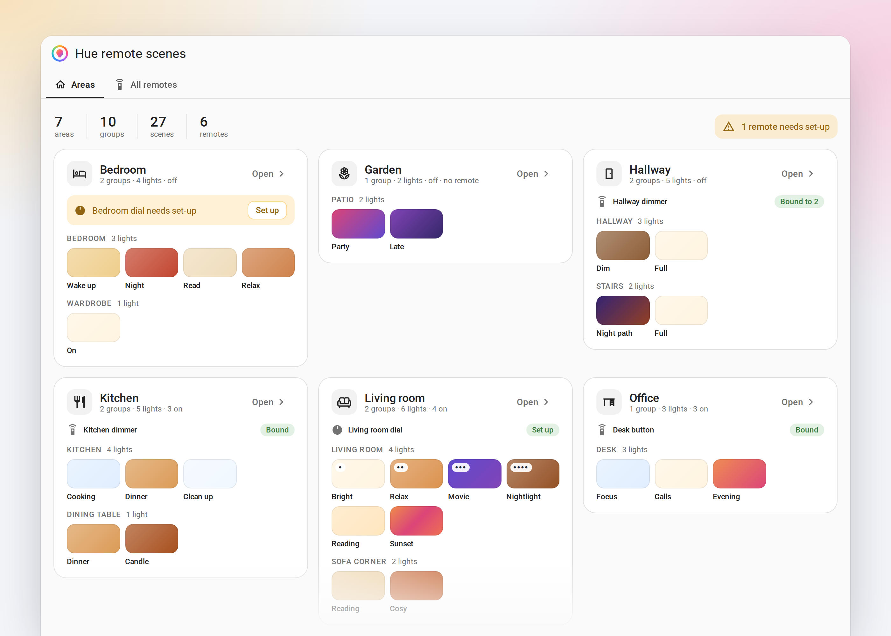
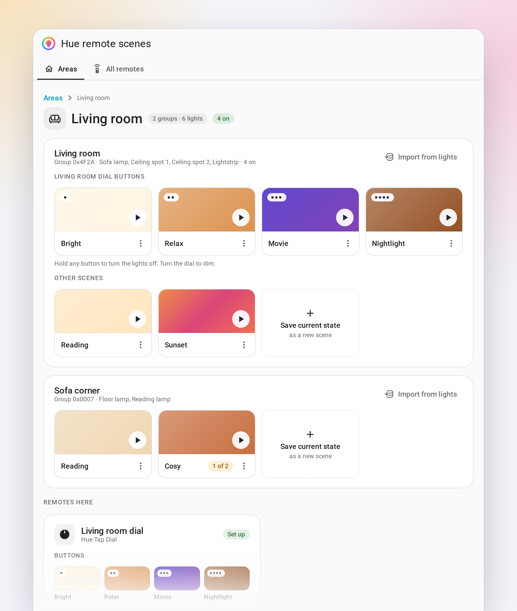

<h1>
  <picture>
    <source media="(prefers-color-scheme: dark)" srcset="custom_components/hue_remote_scenes/brand/dark_logo@2x.png">
    
  </picture>
</h1>

Make your Philips Hue remotes recall scenes stored in your lamps, on Home Assistant's **ZHA**, without a Hue Bridge. Press a button and the lamps change straight away over Zigbee, even when Home Assistant is down.

- **Hue Tap Dial set-up.** Each button recalls its own scene, the dial dims, and holding a button turns the lights off. A guided set-up finds the dial's built-in group, creates it in ZHA with the lamps you pick, and binds the dial. Then you save a scene for each button.
- **Scenes stored in the lamps.** Set a ZHA group's lamps how you want them, then save. Every lamp stores its own state. Each scene also becomes a `scene.` entity for dashboards and automations.
- **Import.** Scenes already stored in your lamps (for example, ones made in Zigbee2MQTT before moving to ZHA) can be read back, then named.
- **Remote → group binding.** Bind remotes to ZHA groups, and see what each remote is bound to.

Built for Hue lamps and remotes. Other Zigbee lamps that support scenes can be in the same groups.

Looking for Hue's preset and animated (dynamic) scenes on ZHA? See [ZHA Scenes by marcelveldt](https://github.com/marcelveldt/zha-scenes). Hue Remote Scenes is about your remotes. If you use both, keep each group managed by one of them.

> ⚠️ Early and experimental. Tested against simulated devices only so far. Please report what works with your lights and remotes.

<p>
  <picture>
    <source media="(prefers-color-scheme: dark)" srcset="docs/areas-dark.png">
    
  </picture>
</p>
<p>
  <picture>
    <source media="(prefers-color-scheme: dark)" srcset="docs/area-dark.png">
    
  </picture>
  <picture>
    <source media="(prefers-color-scheme: dark)" srcset="docs/remotes-dark.png">
    
  </picture>
</p>

## Install

[](https://my.home-assistant.io/redirect/hacs_repository/?owner=elliotwestlake&repository=hue-remote-scenes&category=integration)

**Marketplace** (HA 2026.11+, formerly HACS): use the button above, or **Settings → Marketplace** → ⋮ → Custom repositories → add this repo as an *Integration*. Install, then restart HA. On older HA, both work the same way in HACS.

**Manual:** copy `custom_components/hue_remote_scenes` into your HA `config/custom_components/`, then restart.

Then go to **Settings → Devices & services → Add integration → Hue Remote Scenes**. A **Hue remote scenes** panel appears in the sidebar (admins only).

You need ZHA groups first: **Settings → Devices & services → Zigbee Home Automation → Configure → Groups** (a Tap Dial's set-up creates its own). The panel sorts groups and remotes into your Home Assistant areas, so give lights and remotes an area.

## The panel

- **Areas** shows a tile per area: its remotes, how many lights are on, and each group's scenes as swatches in the colours they were saved with. Tap a swatch to recall it. Areas with a remote that needs setting up come first.
- **Open** an area to manage its scenes and see the remotes in it.
- **All remotes** shows what each remote does (a Tap Dial's four button scenes, or the groups a dimmer controls), its battery and when it was last checked.

## Scenes

1. Set the group's lights to the look you want (from HA or the remotes).
2. Open the area and press **Save current state** at the end of the group's scenes, then name it.
3. Recall it by tapping its swatch, with `scene.turn_on` on its entity (which supports `transition`), or from a bound remote.

The panel says which lights saved it. A light that was off the network when you saved gets flagged "2 of 3"; use **Save current state here** in the scene's ⋮ menu to save it again. Delete (same menu) removes the scene from the lights too. Swatches show what the lights looked like when the scene was saved; imported scenes show grey until you save them again.

Recall is sent to the whole group in one Zigbee message, so the lights change together. Afterwards the lights are re-read so ZHA's light entities show the new state.

### Actions

```yaml
action: hue_remote_scenes.store_scene    # new scene from the current state
data:
  group_id: 5
  name: Relax

action: hue_remote_scenes.store_scene    # overwrite an existing one
data:
  group_id: 5
  scene_id: 1

action: hue_remote_scenes.import_scenes  # read back scenes the lights already have
data:
  group_id: 5
```

Both return a response with the result (which lights saved it, or which scenes were found).

## Remotes

**All remotes** lists devices that send on/off, dimming or scene commands. Press **Bind to…**, pick a group and press **Bind**. Battery remotes sleep, so **press a button on the remote just before** binding or checking bindings.

Hue Remote Scenes remembers what each remote is bound to, so the panel shows what each remote controls without waking anything. Bindings made outside Hue Remote Scenes appear after **Check bindings** on the remote. A group's area is the one set on ZHA's group light entity, or otherwise the areas of its lights.

## Hue Tap Dial scene buttons

Once a Hue Tap Dial is set up, its four buttons recall scenes **stored in the lights**, without Home Assistant. Turning the dial dims, and holding any button turns the lights off. The catch is that each dial always uses its own built-in group, so the lights have to be in a group with exactly that ID. **Set up scene buttons** on the dial's card (or **Set up** on its area) walks you through it:

1. **Find its group:** press one of the dial's scene buttons a few times while Hue Remote Scenes waits. It reads the group ID from the press.
2. **Create the group:** tick the lights the dial should control. Hue Remote Scenes creates a ZHA group with the dial's ID (or adds the lights, if ZHA already has it).
3. **Bind:** press a dial button, then **Bind**.
4. **Save button scenes:** there's a slot per button (● to ●●●●). Set the lights, then **Save current state** in each slot. Later you can change them from the area, where they're shown as the dial's buttons.

The buttons recall scenes 1, 0, 5 and 4 (the IDs come from [Zigbee2MQTT's Tap Dial docs](https://www.zigbee2mqtt.io/devices/8719514440937_8719514440999.html)). Other scenes you save in that group skip those IDs.

## Moving from Zigbee2MQTT

ZHA can take over an existing Zigbee network from Zigbee2MQTT's `coordinator_backup.json` (ZHA setup → *Upload a manual backup*), which may save re-pairing. Scenes and bindings live on the devices, so they come along. Recreate your groups in ZHA **with the same group IDs** as in Zigbee2MQTT, then use **Import from lights**. Keep Zigbee2MQTT's data folder so you can go back.

## Development

```bash
cd frontend && npm install && npm run build   # writes custom_components/hue_remote_scenes/frontend/hue-remote-scenes-panel.js
pytest -q tests                                # pure logic tests (no HA needed)
# End-to-end tests (real zigpy devices, fake radio); need pytest-homeassistant-custom-component:
pytest -q -c tests_ha/pytest.ini --rootdir=tests_ha tests_ha
```

The built bundle is committed so Marketplace users don't need a build step.

Hue Remote Scenes is an independent community project, not affiliated with, endorsed by or supported by Signify (Philips Hue) or Home Assistant. "Hue" is used only to describe the hardware it works with. It was called ZHA Scenes until November 2026; the old data is imported automatically.
